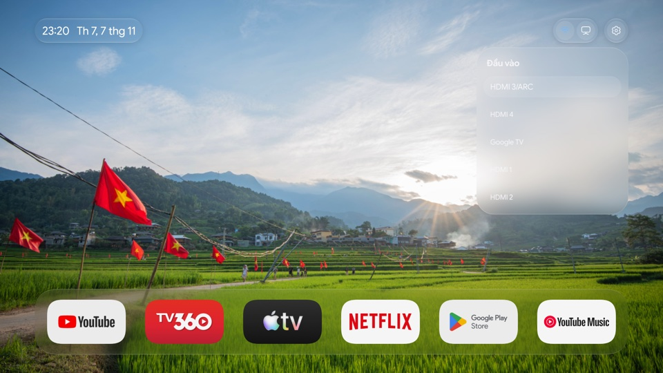
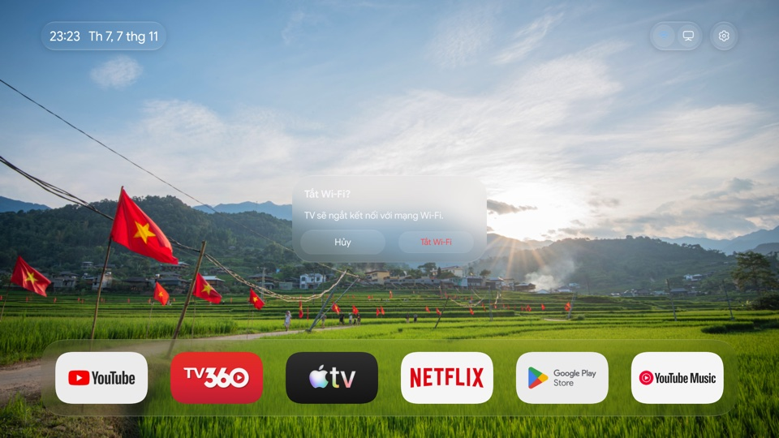

# pdmvOS

[](https://github.com/pdmv/pdmvOS/actions/workflows/ci.yml)
[](https://github.com/pdmv/pdmvOS/releases/latest)

Launcher dùng remote cho Android TV và Google TV, với Dock sáu ô tùy chỉnh, nền kính lấy màu từ hình nền và hoạt ảnh theo focus.


| Danh sách ứng dụng | Menu nhấn giữ |
| --- | --- |
|  |  |

| Chọn đầu vào | Xác nhận tắt Wi-Fi |
| --- | --- |
|  |  |

## Điều khiển

- **Ứng dụng:** Nhấn **Apps** để mở danh sách. Trên TV chuyển phím này cho launcher hệ thống, bật **pdmvOS · Nút Apps** trong **Cài đặt TV → Hỗ trợ tiếp cận**. Nhấn giữ **OK** trên ứng dụng để ghim, bỏ ghim hoặc sắp xếp.
- **Đầu vào:** Nhấn **OK** để mở hoặc đóng danh sách, nhấn **Xuống** để vào danh sách. Chọn một đầu vào để mở hộp thoại xác nhận.
- **Wi-Fi:** Khi Wi-Fi đang bật, nhấn nút Wi-Fi để mở hộp thoại xác nhận. Nhấn giữ để mở cài đặt Wi-Fi của TV.
- **Cập nhật:** Nhấn giữ **Cài đặt** để kiểm tra và tải bản mới. Launcher xác minh APK trước khi chuyển sang màn hình xác nhận cài đặt của Android. Lần đầu, TV có thể yêu cầu cho phép pdmvOS cài ứng dụng từ nguồn này.

## Cài đặt

Máy tính cần **Python 3.9+** và [**Android Platform Tools (adb)**](https://developer.android.com/tools/releases/platform-tools). Bật gỡ lỗi trên TV và chấp nhận kết nối từ máy tính.

Trên macOS hoặc Linux, thay địa chỉ bên dưới bằng IP của TV:

```sh
curl -fsSL https://raw.githubusercontent.com/pdmv/pdmvOS/main/install.py -o pdmvos-install.py
python3 pdmvos-install.py 192.168.1.100
```

Trình cài tải bản ổn định, kiểm tra SHA-256, lưu Home gốc và chọn pdmvOS làm Home. Để khôi phục launcher ban đầu:

```sh
python3 pdmvos-install.py 192.168.1.100 --restore
```

Tải APK hoặc bộ cài ZIP tại [Releases](https://github.com/pdmv/pdmvOS/releases/latest). Xem [hướng dẫn cài đặt](docs/installation.md) cho Windows, ghép nối ADB, đổi hình nền và các lệnh khác.

## Tương thích

Hỗ trợ **Android 8 trở lên (API 26)** và remote D-pad. Đã thử thực tế trên Sony BRAVIA và Xiaomi Mi Box chạy Android 9. Một số tính năng phụ thuộc firmware; xem [phạm vi kiểm thử và giới hạn](docs/testing.md).

## Phát triển

Dự án kết hợp nhân tính toán gốc bằng **Rust** (`pdmvos-core`) và tầng giao tiếp hệ điều hành/kết xuất phần cứng **Java + Android Canvas/HWUI**. Xem [hướng dẫn phát triển](docs/development.md), [quy trình release](docs/releasing.md), [đóng góp](CONTRIBUTING.md) và [báo lỗi bảo mật](SECURITY.md).

## Giấy phép

Mã nguồn và tài liệu dùng [MIT](LICENSE). Font, biểu tượng, ảnh nền và âm thanh có giấy phép hoặc điều khoản riêng tại [NOTICE.md](NOTICE.md) và [ASSETS_LICENSE.md](ASSETS_LICENSE.md). Tên và biểu tượng ứng dụng trong ảnh chụp thuộc các chủ sở hữu tương ứng.
