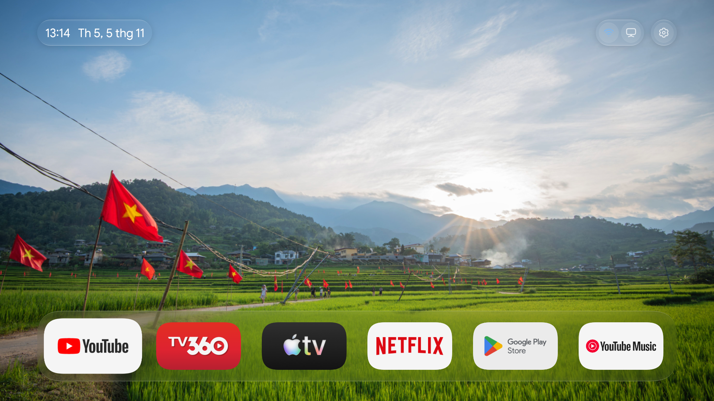
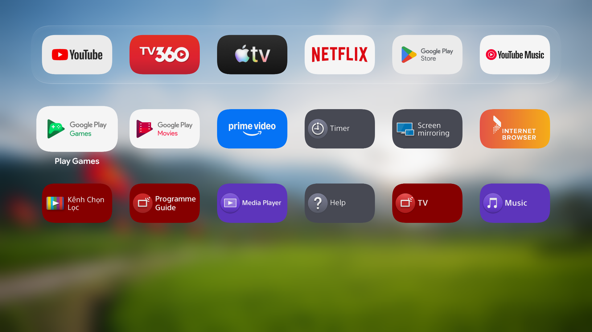
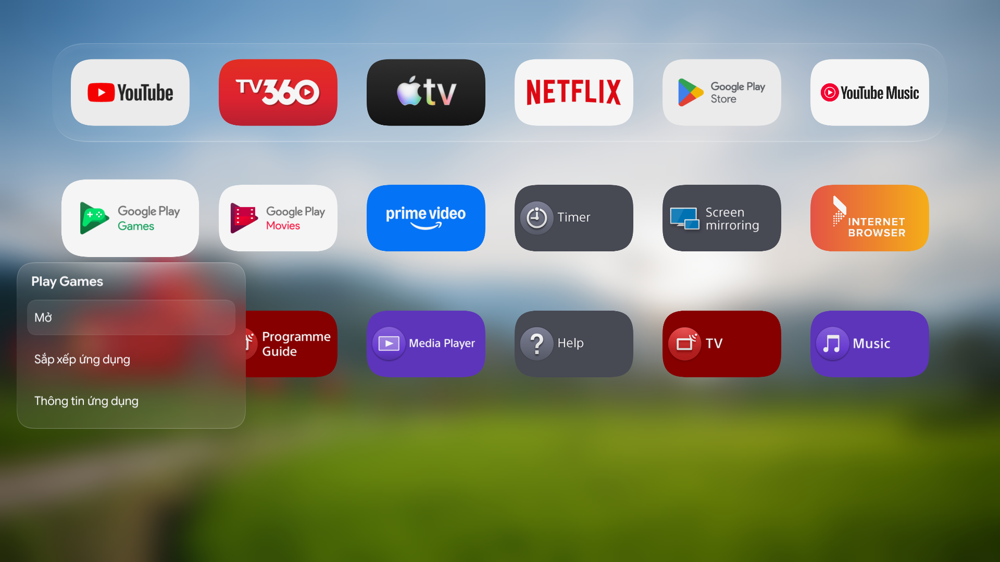

# pdmvOS

[](https://github.com/pdmv/pdmvOS/actions/workflows/ci.yml)
[](https://github.com/pdmv/pdmvOS/releases/latest)

Launcher dành cho Android TV và Google TV, với giao diện kính, Dock tùy chỉnh và hoạt ảnh có quán tính. Điều khiển bằng remote; giữ OK để ghim, sắp xếp hoặc quản lý ứng dụng.



| Danh sách ứng dụng | Menu nhấn giữ |
| --- | --- |
|  |  |

## Cài đặt

Máy tính cần **Python 3.9+** và [**Android Platform Tools (adb)**](https://developer.android.com/tools/releases/platform-tools). Bật gỡ lỗi trên TV và chấp nhận kết nối từ máy tính.

Trên macOS hoặc Linux, thay địa chỉ bên dưới bằng IP của TV:

```sh
curl -fsSL https://raw.githubusercontent.com/pdmv/pdmvOS/main/install.py -o pdmvos-install.py
python3 pdmvos-install.py 192.168.1.100
```

Trình cài tải bản ổn định, kiểm tra SHA-256, lưu Home gốc và chọn pdmvOS làm Home. Để khôi phục launcher ban đầu:

```sh
python3 pdmvos-install.py 192.168.1.100 --restore
```

Tải APK hoặc bộ cài ZIP tại [Releases](https://github.com/pdmv/pdmvOS/releases/latest). Xem [hướng dẫn cài đặt](docs/installation.md) cho Windows, ghép nối ADB, đổi hình nền và các lệnh khác.

## Tương thích

Hỗ trợ **Android 8 trở lên (API 26)** và remote D-pad. Đã thử thực tế trên Sony BRAVIA và Xiaomi Mi Box chạy Android 9. Một số tính năng phụ thuộc firmware; xem [phạm vi kiểm thử và giới hạn](docs/testing.md).

## Phát triển

Dự án dùng Java và Android Canvas/HWUI. Xem [hướng dẫn phát triển](docs/development.md), [quy trình release](docs/releasing.md), [đóng góp](CONTRIBUTING.md) và [báo lỗi bảo mật](SECURITY.md).

## Giấy phép

Mã nguồn và tài liệu dùng [MIT](LICENSE). Font, biểu tượng, ảnh nền và âm thanh có giấy phép hoặc điều khoản riêng tại [NOTICE.md](NOTICE.md) và [ASSETS_LICENSE.md](ASSETS_LICENSE.md). Tên và biểu tượng ứng dụng trong ảnh chụp thuộc các chủ sở hữu tương ứng.
